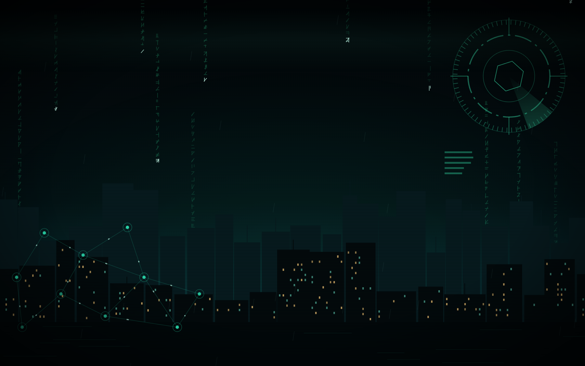

# Section 9 // Net Dive

A dark, animated Claude Code theme inspired by the cyber-noir mood of 1995 anime: phosphor-teal on wet night glass.



## What it does

- **Animated backdrop**: slow green code rain, a rain-soaked night skyline with windows that dim and return, a rotating HUD reticle with a radar sweep, a data-node network with moving packets, scanlines and a drifting scan band. No flashing; with reduced motion it rests as a finished still.
- **Colors**: dark only. Near-black teal-tinted surfaces, phosphor-teal accent, and red, green and amber kept for errors, success and warnings.
- **Message style**: monospace text, clipped-corner HUD panels for your messages, terminal-framed replies and square tool rows.
- **Sound** (off until you press the speaker in the session title bar): low city hum, rain, a quiet drone, and short cues for send, done, ask and error.

Themes draw in the Claude desktop and mobile apps; the terminal and editors are unchanged.

## Install

```
/plugin marketplace add charlieresendiz/section9-theme
/plugin install gits-section9@section9-theme
```

## Editing the backdrop

The scene in `plugins/gits-section9/hooks/scene.js` is generated. Change `tools/gen_scene.py`, then regenerate:

```bash
python3 -I tools/gen_scene.py > plugins/gits-section9/hooks/scene.js
```

All art is original vector work; no logos, characters or artwork from the film are used.

## License

MIT, see [LICENSE](LICENSE).
